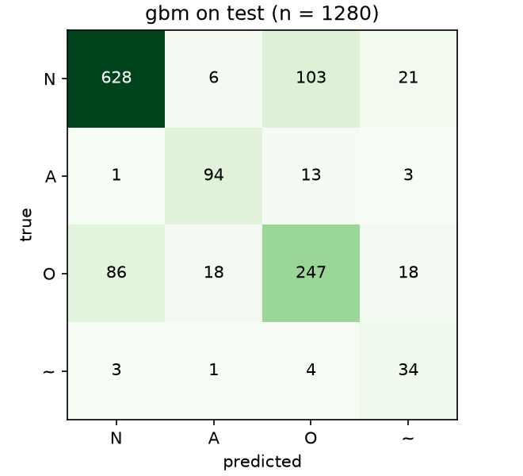
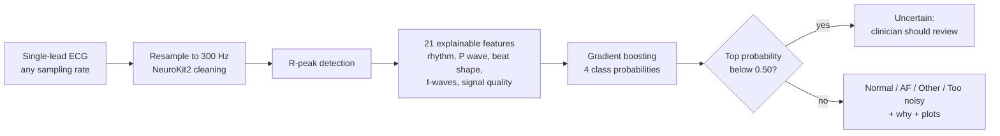

# AF Detect: an explainable, honest AF screening aid for short single-lead ECGs

Upload a 9-61 s single-lead ECG (like a handheld or smartwatch recording) and AF Detect answers **Normal rhythm**,
**Atrial fibrillation**, **Other rhythm** or **Too noisy**, or says **Uncertain** when it is not confident. It shows
why: the detected heartbeats, the time between beats, a Poincaré plot and three key measurements. A gradient-boosting
model on 21 explainable features was chosen on a validation split, **frozen**, and only then tested once on a
held-out test split and on an external database from a different device.

- **Live demo:** [ADD DEMO LINK]
- **Video (3 min):** [ADD VIDEO LINK]

> **Research prototype from a student hackathon. Not a medical device. It cannot rule out heart disease. If you have
> symptoms, contact a doctor or emergency services.**

## 1. Results (run once, after the freeze)

Models, settings and code were frozen at git tag `v1-frozen` before the test split and the external database were
used. 95% CIs: percentile bootstrap, 2,000 resamples (recordings for the test split, people for AFDB). Challenge F1 =
mean F1 of Normal, AF and Other (the official PhysioNet/CinC 2017 score). Full details: [results/RESULTS.md](results/RESULTS.md).

**CinC 2017 test split** (1,280 recordings never used before the freeze)

| Model | Challenge F1 (95% CI) | F1 N | F1 A | F1 O | F1 ~ | AF sensitivity (95% CI) | AF specificity | AF PPV | AF AUROC |
|---|---|---|---|---|---|---|---|---|---|
| rr_rule (baseline) | 0.378 (0.358-0.396) | 0.796 | 0.338 | 0.000 | 0.000 | 0.820 (0.745-0.888) | 0.713 | 0.213 | 0.766 |
| logreg_rr (baseline) | 0.640 (0.608-0.671) | 0.767 | 0.662 | 0.490 | 0.368 | 0.802 (0.724-0.873) | 0.941 | 0.563 | 0.944 |
| **gbm (main)** | **0.780 (0.753-0.805)** | 0.851 | 0.817 | 0.671 | 0.576 | **0.847 (0.773-0.910)** | 0.979 | 0.790 | 0.971 |

**External test: MIT-BIH Atrial Fibrillation Database** (2,466 30-s windows from 23 people; different device, Holter
recordings at 250 Hz). AFDB's "(N" label means all non-AF rhythms, so AF sensitivity and specificity are the main numbers.

| Model | AF sensitivity (95% CI) | AF specificity (95% CI) | Change vs CinC test (sens / spec) |
|---|---|---|---|
| rr_rule | 0.889 (0.840-0.934) | 0.786 (0.701-0.869) | +0.070 / +0.073 |
| logreg_rr | 0.820 (0.700-0.927) | 0.944 (0.888-0.982) | +0.018 / +0.003 |
| **gbm** | **0.825 (0.708-0.932)** | **0.963 (0.936-0.987)** | **-0.022 / -0.016** |

**"Uncertain" (abstain):** below a top probability of 0.50 (threshold chosen on validation data), the app gives no
answer. It keeps 92.7% of test recordings (challenge F1 on them 0.792) and 94.0% of AFDB windows (AF sensitivity 0.856).



More: subgroups and six analysed errors in [results/ERRORS.md](results/ERRORS.md); the validation ablation (feature
sets, class weights, learning rates) in [results/val/ablation.md](results/val/ablation.md).

## 2. Install and reproduce in 4 commands

Python 3.12 and [uv](https://docs.astral.sh/uv/). Everything runs on a laptop CPU (no GPU needed).

```bash
git clone https://github.com/SalemBenafia/af-ecg.git && cd af-ecg
uv venv --python 3.12 && uv pip install -r requirements.txt && uv pip install -e .

make test                  # 1. unit tests on synthetic ECGs
make data                  # 2. download CinC 2017 + AFDB from PhysioNet (open access, checksums verified)
make features train        # 3. 21 features for 8,528 recordings, fit on TRAIN, compare on VAL
make eval-test afdb        # 4. final evaluation on the test split and on AFDB
```

- The split (`configs/splits.csv`, stratified 70/15/15, seed 42) is committed and never regenerated.
- `make eval-test` / `make afdb` refuse to run unless the `v1-frozen` tag exists and `models/`, `configs/` and `src/`
  are unchanged since it. On our machine step 3 rebuilds byte-identical `models/*.joblib`; if your CPU gives
  slightly different floating-point results, run `git checkout v1-frozen -- models/` before step 4 to evaluate the
  exact frozen models.
- Run the demo locally with `make app` (Gradio, http://127.0.0.1:7860).

## 3. Data

| Database | What | Used for |
|---|---|---|
| [PhysioNet/CinC Challenge 2017](https://physionet.org/content/challenge-2017/1.0.0/) | 8,528 AliveCor single-lead recordings, 300 Hz, 9-61 s; labels version 3 (`REFERENCE.csv`) | train / validation / test |
| [MIT-BIH Atrial Fibrillation Database](https://physionet.org/content/afdb/1.0.0/) | 25 long-term two-lead recordings (23 with signals), 250 Hz, rhythm annotations | external test only |

Both are open access under the **Open Data Commons Attribution License v1.0 (ODC-By)**. Please cite:

- Clifford GD, Liu C, Moody B, Lehman LH, Silva I, Li Q, Johnson AE, Mark RG. AF Classification from a Short Single
  Lead ECG Recording: the PhysioNet/Computing in Cardiology Challenge 2017. *Computing in Cardiology* 2017;44.
  [ADD SOURCE: DOI]
- Moody GB, Mark RG. A new method for detecting atrial fibrillation using R-R intervals. *Computers in Cardiology*
  1983;10:227-230. [ADD SOURCE: dataset DOI from the AFDB page]
- Goldberger AL, Amaral LAN, Glass L, Hausdorff JM, Ivanov PCh, Mark RG, Mietus JE, Moody GB, Peng C-K, Stanley HE.
  PhysioBank, PhysioToolkit, and PhysioNet: Components of a new research resource for complex physiologic signals.
  *Circulation* 2000;101(23):e215-e220. doi:10.1161/01.CIR.101.23.e215

## 4. Method



- **Preprocessing:** every recording is resampled to 300 Hz, cleaned with NeuroKit2 and its R peaks detected; a
  recording that fails gets empty (NaN) features and is never dropped.
- **21 explainable features** ([docs/FEATURES.md](docs/FEATURES.md)): 11 rhythm features from the gaps between beats
  (variability, Poincaré shape, entropy), P-wave strength, beat-shape consistency, QRS size, fibrillatory-wave power
  and 6 signal-quality measures.
- **Three models:** a one-feature rule (normalised RMSSD threshold), logistic regression on the rhythm features, and
  the main HistGradientBoosting model on all 21 features (class-balanced).
- **Rigour protocol:** fixed stratified split (70/15/15, seed 42); every choice (features, settings, abstain
  threshold) made on validation; models frozen with a git tag; the test split and AFDB evaluated once afterwards.
- **Abstain rule:** the highest threshold that still keeps at least 90% of validation recordings (0.50) turns
  low-confidence answers into "Uncertain".
- **External test:** non-overlapping 30-s windows of the MIT-BIH AF Database that lie inside one annotated rhythm,
  with confidence intervals that resample people, not windows.

## 5. Limitations

- **Label noise and expert disagreement:** the CinC 2017 labels were revised after the challenge (we use version 3);
  some recordings remain ambiguous, and several of our analysed errors look like disputed labels
  ([results/ERRORS.md](results/ERRORS.md)).
- **No patient IDs in CinC 2017:** the same person may appear in training and test recordings, which can make the
  test result optimistic; this is one reason for the external AFDB test.
- **AF vs Other confusion:** on the test split 13 AF recordings were called Other and 18 Other recordings were called
  AF; irregular rhythms with premature beats and regular-looking AF are the main failure modes.
- **Change on a different device (AFDB):** AF sensitivity -0.022 and specificity -0.016 compared with the CinC test,
  inside wide CIs (only 23 people); 92 of 1,085 AF windows were called "too noisy".
- **Single lead only:** one lead cannot show everything a 12-lead ECG shows.
- **Screening, not diagnosis:** a positive or "Uncertain" result means "a clinician should review this recording";
  the model still misses some AF, so it can never rule AF out. Small subgroups (for example recordings under 20 s)
  are reported as descriptive only.

## 6. Built with

- **NeuroKit2** for ECG cleaning, R-peak detection and signal quality: Makowski D, Pham T, Lau ZJ, Brammer JC,
  Lespinasse F, Pham H, Schölzel C, Chen SHA. NeuroKit2: A Python toolbox for neurophysiological signal processing.
  *Behavior Research Methods* 2021;53(4):1689-1696.
- **wfdb-python** for reading PhysioNet records: [github.com/MIT-LCP/wfdb-python](https://github.com/MIT-LCP/wfdb-python)
  [ADD SOURCE: citation from its PhysioNet software page].
- **scikit-learn** for the models and metrics: Pedregosa F, et al. Scikit-learn: Machine Learning in Python.
  *Journal of Machine Learning Research* 2011;12:2825-2830.
- **Gradio** for the demo, plus NumPy, SciPy, pandas and matplotlib. PyTorch is not used.

**AI-tool disclosure:** the code, tests and documentation were written with the help of Claude Code (Anthropic) under
the team's direction and review; every number in this repository comes from the scripts and result files in it.

## 7. Licence

Code: [MIT](LICENSE). Data: ODC-By 1.0 (see section 3); the six demo recordings in `examples/` come from the CinC 2017
test split.
