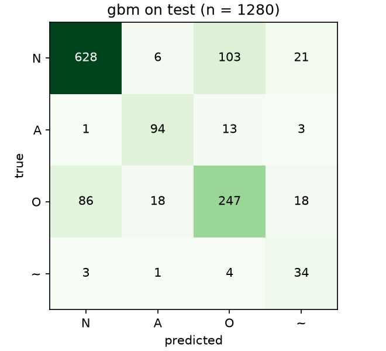
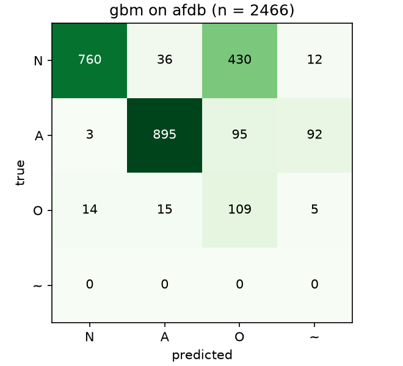

# AF Detect: final results

All numbers below are copied from `results/test/summary.json` and `results/afdb/summary.json` (and one VAL number
from `results/val/summary.json`). Both evaluations were run **once**, after the models, settings and code were
frozen at git tag `v1-frozen` (commit `97d0db3`), with no changes afterwards. CIs are 95% percentile bootstrap
intervals with 2,000 resamples (seed 0): recordings for the test split, source records (people) for AFDB.
There is no CNN result: the optional CNN was dropped from the project.

## 1. CinC 2017 test split (n = 1,280 recordings, never used before the freeze)

| Model | Challenge F1 (95% CI) | F1 N | F1 A | F1 O | F1 ~ | AF sensitivity (95% CI) | AF specificity | AF PPV | AF AUROC |
|---|---|---|---|---|---|---|---|---|---|
| rr_rule | 0.378 (0.358-0.396) | 0.796 | 0.338 | 0.000 | 0.000 | 0.820 (0.745-0.888) | 0.713 | 0.213 | 0.766 |
| logreg_rr | 0.640 (0.608-0.671) | 0.767 | 0.662 | 0.490 | 0.368 | 0.802 (0.724-0.873) | 0.941 | 0.563 | 0.944 |
| **gbm** | **0.780 (0.753-0.805)** | 0.851 | 0.817 | 0.671 | 0.576 | **0.847 (0.773-0.910)** | 0.979 | 0.790 | 0.971 |

Challenge F1 = mean F1 of Normal, AF and Other (the official 2017 score; Noisy is excluded). rr_rule can only
answer Normal or AF, so its Other and Noisy F1 are 0 by design.

## 2. gbm confusion matrix (test split)

| true \ predicted | N | A | O | ~ |
|---|---|---|---|---|
| N | 628 | 6 | 103 | 21 |
| A | 1 | 94 | 13 | 3 |
| O | 86 | 18 | 247 | 18 |
| ~ | 3 | 1 | 4 | 34 |

## 3. Abstain ("Uncertain") result

The gbm says "Uncertain" when its top class probability is below **0.50**; this threshold was chosen on VAL as the
highest one that keeps at least 90% of VAL recordings (`models/abstain.json`).

| Data set | Kept | Challenge F1 on kept (95% CI) | AF sensitivity on kept (95% CI) | AF specificity on kept |
|---|---|---|---|---|
| CinC test | 92.7% (1,187 of 1,280) | 0.792 (0.764-0.820) | 0.855 (0.784-0.920) | 0.980 |
| AFDB | 94.0% (2,317 of 2,466) | 0.655 (0.564-0.727) | 0.856 (0.745-0.947) | 0.975 |

Without abstaining, the gbm scores challenge F1 0.780 and AF sensitivity 0.847 on the test split.

## 4. External test: MIT-BIH AF Database (AFDB)

2,466 non-overlapping 30-s windows (N 1,238 / A 1,085 / O 143) from 23 people, first ECG lead, 250 Hz resampled to
300 Hz. AFDB "(N" means **all non-AF rhythms**, not "normal", so the main external numbers are AF sensitivity and
specificity; CIs resample whole people (23 source records).

| Model | AF sensitivity AFDB (95% CI) | AF specificity AFDB (95% CI) | AF sensitivity CinC test | AF specificity CinC test | Change in sensitivity | Change in specificity |
|---|---|---|---|---|---|---|
| rr_rule | 0.889 (0.840-0.934) | 0.786 (0.701-0.869) | 0.820 | 0.713 | +0.070 | +0.073 |
| logreg_rr | 0.820 (0.700-0.927) | 0.944 (0.888-0.982) | 0.802 | 0.941 | +0.018 | +0.003 |
| **gbm** | **0.825 (0.708-0.932)** | **0.963 (0.936-0.987)** | 0.847 | 0.979 | **-0.022** | **-0.016** |

Change = AFDB minus CinC test, computed from the unrounded values in the two summary files.

gbm on AFDB, confusion (rows = true, columns = predicted N / A / O / ~; there are no true Noisy windows):
"(N" 760 / 36 / 430 / 12; AF 3 / 895 / 95 / 92; Other 14 / 15 / 109 / 5.

The 4-class challenge F1 on AFDB (gbm 0.639, 95% CI 0.551-0.708) is not comparable with CinC, because AFDB's
"(N" class contains other rhythms that the model may correctly call "Other". PPV on AFDB (gbm 0.946) is also not
comparable: AF makes up 44% of the AFDB windows (1,085 of 2,466) but only about 9% of the CinC test recordings (111 of
1,280, the AF row of the test confusion matrix).

## 5. What the numbers mean

1. On the held-out CinC test split, scored once after the freeze, the gbm reaches a challenge F1 of 0.780
   (95% CI 0.753-0.805), clearly above both baselines, and close to its VAL estimate of 0.767
   (`results/val/summary.json`), so model selection on VAL did not inflate the result.
2. For AF itself the gbm misses about 1 in 7 AF recordings (sensitivity 0.847) and is right about 4 times out of 5
   when it says AF (PPV 0.790); its biggest weakness is not AF but telling Normal from Other (103 Normal recordings
   called Other, 86 Other called Normal).
3. On AFDB, a different device, Holter recordings and 23 different people, AF sensitivity (0.825) and specificity
   (0.963) drop by only 0.022 and 0.016, well inside the wide CIs that come from having only 23 people; but 92 of
   1,085 AF windows were called "too noisy", which shows that the quality features do not transfer perfectly.
4. Abstaining keeps 92.7% of test recordings and raises challenge F1 only from 0.780 to 0.792 (CIs overlap), so the
   "Uncertain" answer is a modest safety margin, not a fix for the model's errors.
5. This is a single-lead research prototype trained on labels with known expert disagreement and without patient
   IDs (the same person may appear in training and test data): a positive or "Uncertain" result means "a clinician
   should review this recording", and because it still misses some AF it can never be used to rule AF out.
